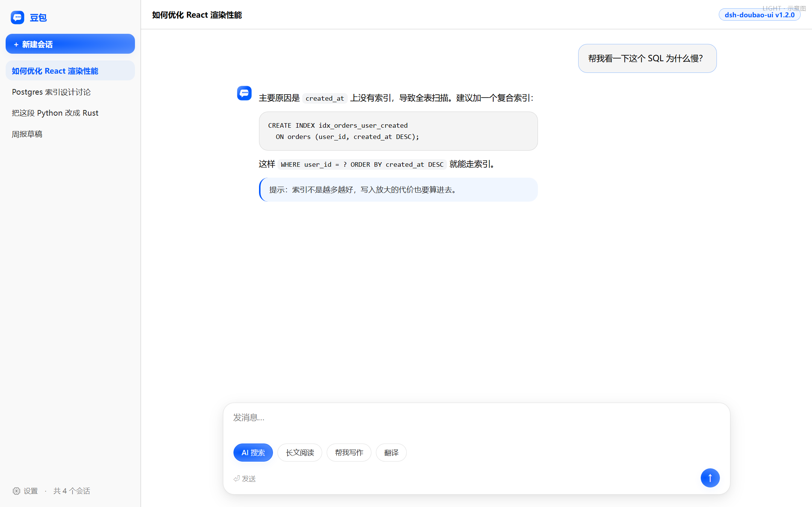
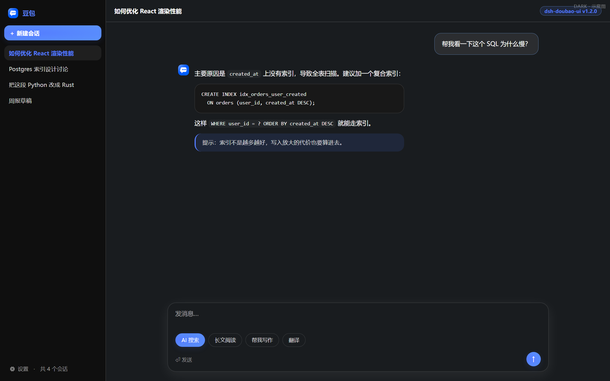

# dsh-doubao-ui

**A Doubao-inspired skin for the [DeepSeek Harness](https://www.deepseek.com/harness/) Web client.**




> These are **mockups** rendered by `node scripts/preview.mjs`, not screenshots of
> DSH. The layout is hand-written and does not reflect the host's real DOM density
> or spacing; check the live app for the true result.

> [!IMPORTANT]
> This is an **unofficial, community-maintained plugin**. It is not a product of ByteDance / Doubao, nor of DeepSeek AI, and has no authorization or endorsement from either. Trademarks belong to their respective owners and are used only to describe the visual inspiration and compatibility.
>
> The plugin changes **only colors and geometry**. It does not touch models, session data, the network, or tool registration.

## What it does

- Replaces DSH's full `--dsw-alias-*` / `--dsw-static-*` semantic token set with a Doubao-style palette: the `#0057FF` brand blue, cool neutral surfaces, functional colors, code/markdown fills, scrollbars and menus.
- Full **light and dark** palettes, both derived from Doubao Web's shipped CSS design tokens (measured, not guessed). Dark is not a simple inversion: three background tiers `#121317` / `#191C1F` / `#1E2123` with the brand lifted to `#547CFF`.
- Doubao geometry: 16px bubbles, 20px composer, 10px buttons, `9999px` pills, `--s-shadow-lv1/2/3` shadows.
- Composer focus ring, brand-gradient send button, glassy shortcut pills, unified code-block radii.
- Font normalization via zero-specificity `:where()` (only UA defaults are overridden; no other plugin's intentional typography is touched).
- Respects `prefers-reduced-motion`; does not break DSH's keyboard-only focus ring.

### Relation to `dsh-theme-doubao`

The existing [zdz6215591/dsh-theme-doubao](https://github.com/zdz6215591/dsh-theme-doubao) replaces the **sidebar brand mark and the new-conversation hero artwork**, but does not restyle colors. This plugin is the complementary half: **full-site color + geometry**, with no React component replacement, no DOM injection and no image assets. Both can be installed together (one uses slots, the other CSS variables).

## Why pure CSS token overrides

All DSH Web surfaces consume `--dsw-alias-*` variables from `body`. Replacing them at the variable layer changes the whole UI without touching a single business component:

- **Zero dependencies** — no React, no bundler, no `npm install` needed.
- **Upgrade-safe** — never targets DSH's content-hashed CSS Module class names. Selectors use `:root` / `body` / measured `data-*` anchors only.
- **Reversible** — the stylesheet is owned by `ctx.effect`; disabling the plugin fully restores the official UI.
- **Cannot white-screen** — the DSH loader does not isolate entry factories; one throwing factory can take down the whole shell. Every initialization step here is wrapped and degrades to an inert module.

Selector specificity: the host ships palettes via `body`, `body[data-ds-dark-theme]` and `html[data-platform=darwin] body`. This skin prefixes light/dark with `:root:root`, reaching `(0,2,1)` / `(0,3,1)` so it wins deterministically regardless of stylesheet order.

## Install

```bash
# from npm (once published)
dsh plugin --profile desktop add dsh-doubao-ui

# from GitHub (client/client.js is committed; no prepare script, no build on install)
dsh plugin --profile desktop add github:JAKE1266/dsh-doubao-ui

# from a local clone
git clone https://github.com/JAKE1266/dsh-doubao-ui.git
cd dsh-doubao-ui
node scripts/build.mjs && node test/run-all.mjs
dsh plugin --profile desktop add link:$(pwd)
```

Replace `desktop` with the profile actually running `dsh web` (check with `dsh --profile desktop --dump-config`).

**Activate:** restart DSH Web, then hard-refresh the browser (`Ctrl+Shift+R`). In DevTools, `<html>` should carry `data-dsh-doubao-skin="1.1.1"` and `<head>` should contain both `<style data-plugin="dsh-doubao-ui" data-plugin-css="dsh-doubao-ui/skin.css">` and `.../components.css"`.

## What's new in 1.1.0

A second **component layer** on top of the CSS skin, registered declaratively
via official `ctx.slots`:

- `sidebar.brand.mark` / `sidebar.brand.name` — an original conversation-bubble
  mark (inline SVG, no copied assets) + the name, shadowing the official brand
  occupant with `priority:-1`.
- `conversation.hero.brand.mark` — large mark on the new-conversation page.
- `conversation.hero.options` — four quick-action pills using the measured
  on-site copy: `AI 搜索 / 帮我写作 / 图像生成 / 翻译` (notably **not** "深度思考").
- `settings.section` — an About page covering capabilities, provenance and rollback.

Safety: the component layer never calls `require('react')` at module top level.
React is bound lazily; if the host seed modules are missing, the whole component
layer degrades to an inert no-op and the CSS skin still works. This is verified
by the test suite because the DSH loader does not isolate entry factories.

**Disable / remove:**

```bash
dsh plugin --profile desktop disable dsh-doubao-ui
dsh plugin --profile desktop remove dsh-doubao-ui
```

Hard-refresh once and the official UI is back — no manual cleanup.

## Customizing

All design values live in [`src/tokens.mjs`](src/tokens.mjs). After editing, rebuild (the output is committed):

```bash
node scripts/build.mjs
node test/run-all.mjs
```

`test/run-all.mjs` enforces **identical key sets between the light and dark palettes** — the single most effective guard against a token being forgotten in dark mode.

### Provenance of the color values

This is an **inspired-by redesign**, not a pixel-for-pixel copy of proprietary assets.

- Brand, neutral ramps, radii, composer geometry, shadows, fonts and gradients come from Doubao Web's **shipped CSS bundle** (measured): `https://lf-flow-web-cdn.doubao.com/obj/flow-doubao/doubao/chat/static/css/chat.73c59e003d.css`, plus the server HTML at `https://www.doubao.com/chat/`.
- The **mapping** from Doubao tokens to DSH `--dsw-alias-*` is a design judgment (the two systems have different semantics); some intermediate states, mask opacities and the 15px font baseline were adapted for DSH.
- The repository contains **no images, icons or fonts** taken from the Doubao client.

See [`docs/DESIGN.md`](docs/DESIGN.md) for the full mapping table with per-item 实测 (measured) / 推导 (derived) labels and the list of failed/skipped sources.

## Verification

```bash
node test/run-all.mjs
```

Zero-dependency suite: output syntax + factory contract, dual-theme CSS blocks, light/dark key-set parity (200 tokens), idempotent injection & teardown, graceful degradation when `apply` faces any host anomaly, manifest consistency. CI runs the same suite on push / PR.

## Layout

```
client/client.js      built artifact (the file actually loaded)
src/tokens.mjs        all design tokens — the only file you normally edit
src/client.mjs        browser half: injection, surface markers, lifecycle
lib/index.mjs         host half: empty Loader seat
scripts/build.mjs     zero-dependency bundler (src → client/client.js)
test/run-all.mjs      zero-dependency verification
cordis.patch.yml      profile bundle mount
docs/DESIGN.md        design spec & provenance
```

## FAQ

**Nothing changed after install?** Confirm you installed into the profile actually running DSH Web, then **restart DSH Web** and hard-refresh. `dsh --profile desktop --dump-config` should list `dsh-doubao-ui`.

**Does it touch my sessions, workspaces or files?** No. It writes one `<style>` into `<head>` and adds a few `data-doubao-*` marker attributes. No file I/O, no network, no tools or services registered.

**Can I use it with other skins?** It coexists with slot-based brand plugins (e.g. `dsh-theme-doubao`). **Two skins that both override `--dsw-*` tokens will conflict** (last-loaded wins), so do not enable it alongside `dsh-zcode-ui`. Disable one and hard-refresh.

## License

[MIT](LICENSE) for the code. Visual inspiration and names belong to their respective owners.
